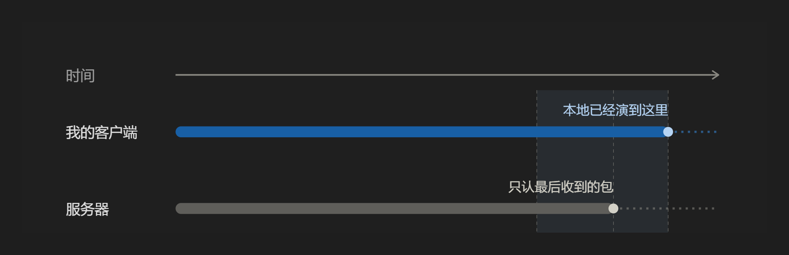

单纯的复盘分析

## 现象

失步在画面上有四类形态：位置瞬移、起点错误（弱网穿墙出勾）、交互单向、结算集中到账——本质都不是渲染 bug，而是"谁在何时拥有最终解释权"的问题。

## 原理

- 客户端预测先行、服务器权威裁决：本地先演、服务器后裁，断线即分叉；
- 延迟补偿（回溯）默认"上报时刻可信"，任何扭曲该时刻的手段都会让判定落错；
- 他人看到的只是插值/外推的结果，方向一错就变成滑步或瞬移。这也是深蓝的倒地瞬移BUG与对疾风的回拉打断的由来。

## 案例

S11 更新修复"深蓝利用弱网状态穿墙出勾"：漏洞不在钩爪动作，而在钩爪**起点**——服务器校验了动作与冷却，却没校验路径几何。修法：起点改用服务器认可的位置，路径做服务器侧碰撞判定，让非法起点在规则上根本不成立。

## 声明

该脚本从未用于任何实战对局，仅验证可行性后即未再使用，未传播、未出售、未转交他人；本文不含可执行代码与复现步骤，如有不当请联系删除。

---

# Desync Post-Mortem: Where Is the Trust Boundary?

A conceptual post-mortem on network desynchronization in shooters. No code, parameters, or reproduction steps are included.

## Symptoms

Desync shows up as four "bug-like" patterns: position teleporting, wrong ability origin (a hook launched through walls on weak networks), one-sided interactions, and burst reconciliation. None of them is a rendering bug — all are about *who holds final authority, and when*.

## Mechanism

- Client-side prediction runs ahead of server authority; they diverge once the link drops.
- Lag-compensation rollback trusts the client-reported instant — distorting that instant makes the verdict land wrong.
- What others see of you is interpolation/extrapolation, not your true position.

The real question is not latency in milliseconds but where the trust boundary is drawn.

## Case Study

An S11 patch fixed "the hook launching through walls on weak connections": the bug was not the hook action but its **origin** — the server validated the action and cooldown, but not the path geometry. The fix moved origin and path validation to the server, making an invalid origin impossible by rule.

## Disclaimer

The script was never used in any real match, was not distributed, sold, or handed to anyone, and no executable code or reproduction steps are included. Contact me to remove this material if anything is inappropriate.
